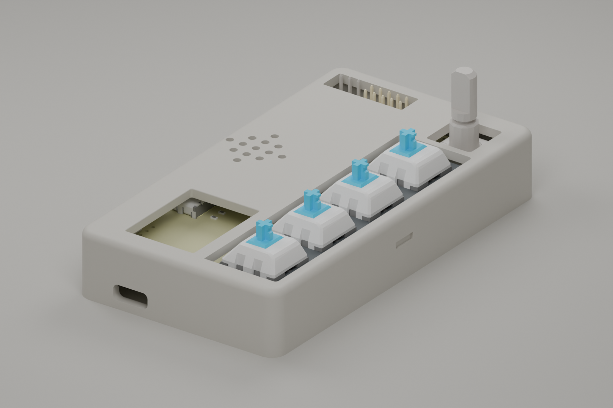
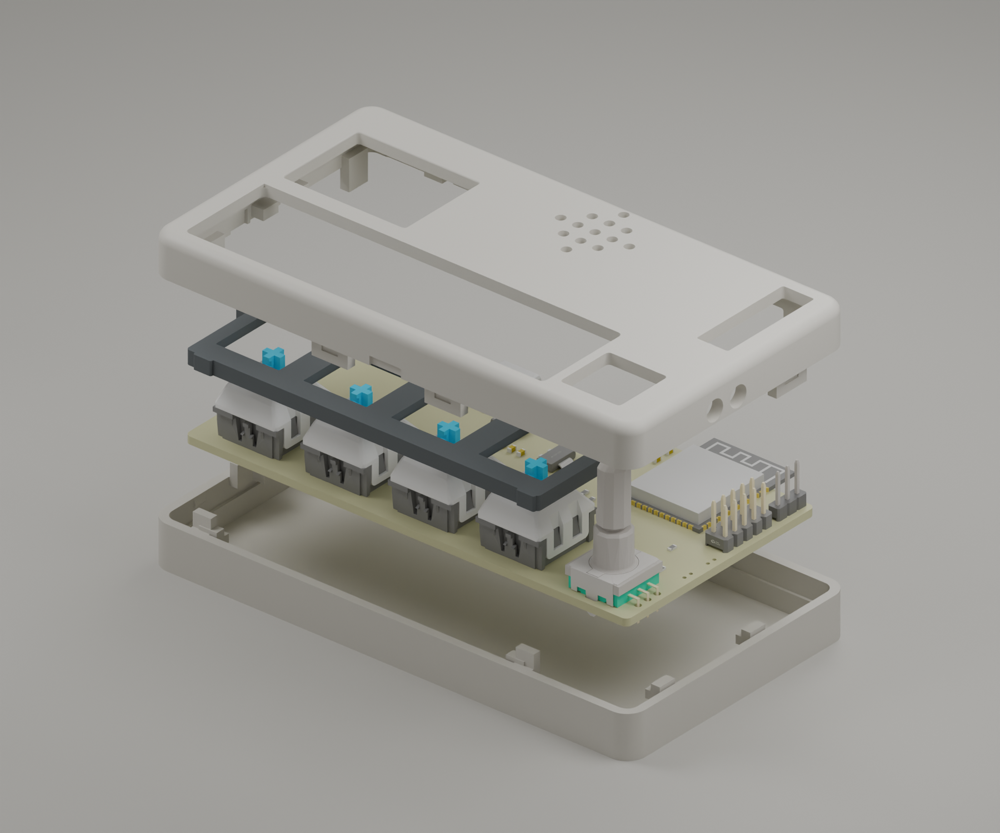
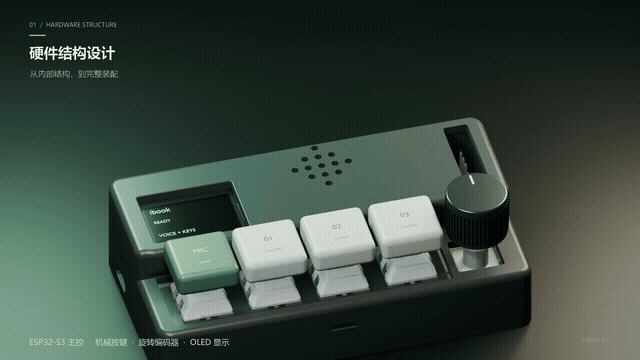

# product-enclosure-design

给 AI Agent 使用的通用三维外壳设计 Skill：从实测尺寸、CAD/PCB 参考和装配需求出发，设计外壳并复核开孔、配合、网格与导出。

适用于仪器、控制器、工具、消费品与保护壳。设计方法可使用目标环境的 CAD 或 Blender；附带一个独立的参数化盒壳生成器，不要求旧工程或私人模型。

## 先看效果

**语音快捷键盘外壳案例**：围绕 PCB、按键、旋钮和接口安排外形与开孔，并通过装配图和分解图检查结构关系。



| 完整装配 | 结构分解 |
| --- | --- |
| 外壳与操控件的空间关系、面板和侧面开孔 | 上盖、定位结构、PCB 与底壳的层次关系 |
| [查看装配原图](docs/media/keyboard-assembly.png) | [查看分解原图](docs/media/keyboard-exploded.png) |



### 动态拆装演示

[](https://raw.githubusercontent.com/Ibook000/product-enclosure-design/main/docs/media/keyboard-exploded.mp4)

**[▶ 观看拆装视频 · 10 秒 / 720p / 静音](https://raw.githubusercontent.com/Ibook000/product-enclosure-design/main/docs/media/keyboard-exploded.mp4)** · [打开 MP4 文件页](docs/media/keyboard-exploded.mp4) · [案例设计方法](references/keyboard-case.md)

静态图来自 v15a 外壳设计工程；视频来自同一产品的展示工程，外观、键帽和材质属于不同展示版本。画面用于说明结构与拆装表达，具体尺寸和配合应以目标设计工程为准。更多信息见 [素材说明](docs/media/README.md)。

## 从尺寸到交付

实测尺寸 / CAD / PCB → 确定基准与装配约束 → 建模与开孔 → 装配和试片复核 → 源工程、分件 STL、预览及检查报告。

## 包含内容

- 尺寸来源、单位、坐标基准和待测项的管理。
- 屏幕、插头包胶、操控件、拆装与运动包络的检查方法。
- 壁厚、止口、固定、试片、支撑与工艺选择的边界。
- Blender 圆角矩形上下壳、定位止口、螺柱、矩形和圆孔生成示例。
- 标准库 STL 检查：有限数值、边连接、定向、分量、退化、法向、体积及 float32 量化。
- 导出后尺寸回读、装配到打印坐标记录、明确清单打包和 SHA256。

拓扑检查不等于自交、全局壁厚、强度、实物配合或可打印性认证。示例参数是合成测试值，定位止口不是锁扣，孔不自动构成螺纹。复杂曲面、卡扣、真实螺纹、注塑/CNC 或精确 STEP 需对应工具与任务适配器。

## 安装和交给其他 AI

下载仓库，或复制整个目录到目标 Agent 的技能目录。支持技能调用时使用 `$product-enclosure-design`；其他 AI 先读 [SKILL.md](SKILL.md) 及相对参考即可。

```text
请读取 product-enclosure-design/SKILL.md，根据我的产品设计外壳。
尺寸与基准资料：……
接口、固定和维护需求：……
制造工艺与材料：……
保留源工程，核对装配与导出，明确待测和未验证项。
```

例如 Codex：

```bash
git clone https://github.com/Ibook000/product-enclosure-design.git ~/.codex/skills/product-enclosure-design
```

Windows 或其他 Agent 请使用其技能目录，也可直接下载 ZIP。无需特定插件或平台二进制 Python 扩展。

## 运行合成示例

Python 3.10+；只读 STL 检查不需要第三方包。建模需要 Blender 4.2+：

```bash
python scripts/enclosure.py init work/project.json
python scripts/enclosure.py check work/project.json
python scripts/enclosure.py build work/project.json --blender /path/to/blender
python scripts/enclosure.py verify work/project.json
python scripts/enclosure.py package work/project.json
python scripts/enclosure.py mesh-check part.stl --units mm --report report.json
```

也可通过配置、BLENDER_BIN 或 PATH 指定 Blender。生成器保存 .blend、分件 STL、装配/拆分预览和检查报告；按配置与脚本签名保存版本。详情见 [项目格式](references/project-format.md)。

已在 Windows、Python 3.13、Blender 4.5.9 验证合成模板，以及独立的不同尺寸/圆孔盒壳；检查了 STL 尺寸回读、连通分量、边连接、绕序、退化、NaN 拒绝和打包清单。未将这些结果扩展为其他系统、实物配合、完整自交、全局壁厚或打印认证。

## 相关技能

- [product-showcase-film](https://github.com/Ibook000/product-showcase-film)：产品三维运镜、实拍和功能动效视频。
- [jlc-easyeda-design](https://github.com/Ibook000/jlc-easyeda-design)：嘉立创EDA原理图与 PCB 设计。

它们不是本仓库的运行依赖。本公共仓库不包含原始键盘 CAD、实际 PCB 或私人制造资料。
